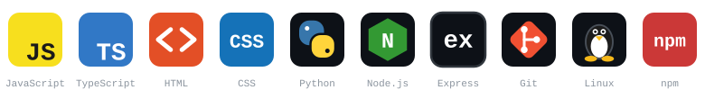

<div align="center">


<br/>

<a href="https://github.com/viniciuzbyte"></a>
<a href="https://zapo.to/en/introduction"></a>


</div>

## whoami

```ts
type Focus =
  | "Software Development"
  | "JavaScript Ecosystem"
  | "Open Source"
  | "Building Useful Tools";

interface Developer {
  readonly username: string;
  readonly alias: string;
  readonly role: string;
  readonly interests: readonly Focus[];
  readonly currentlyLearning: string;
  readonly motto: readonly string[];
}

export const eis = {
  username: "viniciuzbyte",
  alias: "Eis",
  role: "Developer & Open Source Contributor",
  interests: [
    "Software Development",
    "JavaScript Ecosystem",
    "Open Source",
    "Building Useful Tools",
  ],
  currentlyLearning: "Always something new",
  motto: ["Build.", "Break.", "Learn.", "Repeat."],
} as const satisfies Developer;
```

I enjoy exploring technology, experimenting with new ideas, and contributing to projects that make a difference. I learn best through real-world projects and open-source collaboration, and I'm always looking for the next interesting thing to build.

## tech_stack

<div align="center">



</div>

## open_source

<div align="center">

<a href="https://zapo.to/en/introduction"></a>
<a href="https://github.com/vinikjkkj/zapo"></a>
<a href="https://www.npmjs.com/package/zapo-js"></a>

</div>

**Zapo.js** is a TypeScript library focused on the WhatsApp Web protocol, built for performance, scalability, and configurable multi-session support. I'm proud to have contributed to the ecosystem.

## stats

<div align="center">



</div>

## arcade

<div align="center">





</div>

## play_me_at_tic_tac_toe

Click a square to open a pre-filled issue, submit it, and a GitHub Action plays your move and the bot's reply.

<!-- TTT:START -->
<div align="center">



**Your move — you are ❌, the bot is ⭕.**

| | A | B | C |
|:-:|:-:|:-:|:-:|
| **1** | [`A1`](https://github.com/viniciuzbyte/viniciuzbyte/issues/new?title=ttt%7Cmove%7CA1&body=Just%20press%20Submit%20new%20issue.%20The%20board%20updates%20in%20a%20few%20seconds.) | [`B1`](https://github.com/viniciuzbyte/viniciuzbyte/issues/new?title=ttt%7Cmove%7CB1&body=Just%20press%20Submit%20new%20issue.%20The%20board%20updates%20in%20a%20few%20seconds.) | [`C1`](https://github.com/viniciuzbyte/viniciuzbyte/issues/new?title=ttt%7Cmove%7CC1&body=Just%20press%20Submit%20new%20issue.%20The%20board%20updates%20in%20a%20few%20seconds.) |
| **2** | [`A2`](https://github.com/viniciuzbyte/viniciuzbyte/issues/new?title=ttt%7Cmove%7CA2&body=Just%20press%20Submit%20new%20issue.%20The%20board%20updates%20in%20a%20few%20seconds.) | [`B2`](https://github.com/viniciuzbyte/viniciuzbyte/issues/new?title=ttt%7Cmove%7CB2&body=Just%20press%20Submit%20new%20issue.%20The%20board%20updates%20in%20a%20few%20seconds.) | [`C2`](https://github.com/viniciuzbyte/viniciuzbyte/issues/new?title=ttt%7Cmove%7CC2&body=Just%20press%20Submit%20new%20issue.%20The%20board%20updates%20in%20a%20few%20seconds.) |
| **3** | [`A3`](https://github.com/viniciuzbyte/viniciuzbyte/issues/new?title=ttt%7Cmove%7CA3&body=Just%20press%20Submit%20new%20issue.%20The%20board%20updates%20in%20a%20few%20seconds.) | [`B3`](https://github.com/viniciuzbyte/viniciuzbyte/issues/new?title=ttt%7Cmove%7CB3&body=Just%20press%20Submit%20new%20issue.%20The%20board%20updates%20in%20a%20few%20seconds.) | [`C3`](https://github.com/viniciuzbyte/viniciuzbyte/issues/new?title=ttt%7Cmove%7CC3&body=Just%20press%20Submit%20new%20issue.%20The%20board%20updates%20in%20a%20few%20seconds.) |

No moves yet — be the first. · [🔄 Restart](https://github.com/viniciuzbyte/viniciuzbyte/issues/new?title=ttt%7Cnew&body=Just%20press%20Submit%20new%20issue.%20The%20board%20updates%20in%20a%20few%20seconds.)

Games **0** · Humans **0** · Bot **0** · Draws **0**

</div>


<!-- TTT:END -->

## contribution_snake

<div align="center">

<picture>
  <source media="(prefers-color-scheme: dark)" srcset="https://raw.githubusercontent.com/viniciuzbyte/viniciuzbyte/output/github-contribution-grid-snake-dark.svg" />
  <source media="(prefers-color-scheme: light)" srcset="https://raw.githubusercontent.com/viniciuzbyte/viniciuzbyte/output/github-contribution-grid-snake.svg" />
  
</picture>

</div>

<div align="center">

Thanks for stopping by. Keep building, keep learning, keep creating.

</div>
